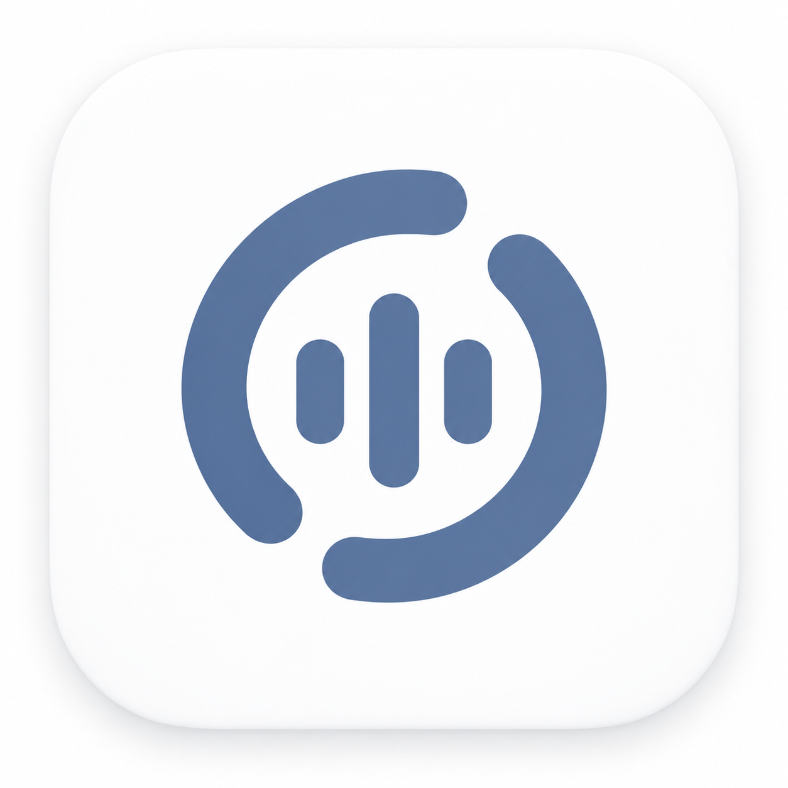

<p align="center"></p>

# DM Control

Личный форк [Hex](https://github.com/anomalyco/hex) для macOS: локальная диктовка и голосовое управление компьютером после фразы «Hello Hex».

Форк сохраняет диктовку Hex по горячей клавише и добавляет отдельный режим для повседневных действий: громкости, воспроизведения, яркости внешнего монитора, подсветки Digital Light, блокировки и сна. Фразу активации можно изменить. Обращение распознаётся небольшой локальной моделью; выбранная модель Hex распознаёт команду после обращения. Облачный ИИ для этих команд не используется.

## Голосовое управление

Включите **Labs → Voice control**. По умолчанию режим выключен. В поле **Wake phrase** можно задать от двух до пяти английских слов и нажать **Apply phrase**. Команды поддерживаются на русском и английском; по окончании команды достаточно сделать паузу.

| Пример после «Hello Hex» | Действие |
| --- | --- |
| «Сделай тише», «Сделай громче» | Изменить громкость на 10 пунктов |
| «Громкость пятьдесят процентов» | Установить громкость 50% |
| «Выключи звук», «Включи звук» | Выключить или вернуть звук |
| «Поставь на паузу», «Продолжи воспроизведение» | Управлять текущим медиаплеером |
| «Следующий трек», «Предыдущий трек» | Переключить трек |
| «Сделай ярче», «Яркость 70 процентов» | Изменить яркость внешнего монитора через DDC |
| «Включи подсветку», «Выключи подсветку» | Прочитать состояние Digital Light и при необходимости отправить его хоткей |
| «Переключи режим подсветки» | Отправить хоткей смены режима Digital Light |
| «Заблокируй компьютер», «Усыпи компьютер» | Заблокировать Mac или перевести в сон |
| «Отмена» | Не выполнять действие |

Для русских команд выберите в Hex модель с поддержкой русского, например Parakeet v3 или Whisper. Английская фраза активации не ограничивает язык команды.

Режим использует общий микрофонный поток Hex. Диктовка по кнопке имеет приоритет. Команды ограничены явным списком действий; распознанный текст не исполняется как код или команда shell. Аудио команд не сохраняется.

Голосовое управление работает, пока Mac бодрствует. После системного сна приложение не может услышать фразу пробуждения.

## Локальные интеграции

- **Digital Light:** используется существующий хоткей `⌘⌥⌃⇧1` для питания и `⌘⌥⌃⇧2` для режима. Приложение Digital Light должно быть запущено. Для отдельных команд «включи» и «выключи» проверяется его сохранённое состояние `saved_isOn`.
- **Медиа:** используется `nowplaying-cli`.
- **Внешний монитор:** яркость и громкость неподдерживаемых системным микшером выходов управляются через `m1ddc`. Монитор и подключение должны поддерживать DDC/CI.

В текущей личной конфигурации `nowplaying-cli` и `m1ddc` уже установлены. На другом Mac их нужно установить отдельно. Поддержка яркости встроенного дисплея в голосовом режиме пока не добавлена.

## Сборка на macOS

Нужны Mac с Apple Silicon, macOS 15+, Rust, Xcode с Metal toolchain и CMake. Сборка проверяется с Xcode 26.3 и SDK 26.2; для Foundation Models сохранена совместимость с этим SDK.

```sh
bash scripts/build-app.sh
```

Результат: `target/app/DM Control.app`. При отсутствии `HEX_TEAM_ID` приложение подписывается ad hoc для локального использования. Данные лежат отдельно, в `~/Library/Application Support/dm-control`, а TypeScript-конфиг — в `~/.config/dm-control/hex.config.ts`. Оригинальный Hex не заменяется. Самообновление из каналов исходного проекта отключено.

При первом запуске macOS потребует разрешения на микрофон, Accessibility и, для некоторых действий, Automation. Модель диктовки выбирается и загружается в приложении.

## Проверка без микрофона и выполнения команд

Внутренний исполняемый файл по совместимости называется `hex`.

```sh
cargo build --bin hex
./target/debug/hex voice-control --text 'Hello Hex, громкость пятьдесят процентов'
./target/debug/hex voice-control --wav hello-hex.wav
./target/debug/hex voice-control --wav another-phrase.wav --phrase 'Hey Computer'
scripts/check voice_control
```

Эти проверки выводят распознанное действие или число обнаружений фразы, не открывают микрофон и не выполняют системные действия.

Подробности реализации, нагрузки и проверки: [голосовое управление](docs/features/voice-control.md). Документация унаследованных возможностей Hex: [карта функций](docs/features/README.md).

## Основа и лицензии

DM Control основан на [anomalyco/hex](https://github.com/anomalyco/hex), исходный снимок `f42787ba24cf6034395e57f8c5ee59aaf73a9415` из ветки `dev`, версия пакета 3.1.1. Автор исходного проекта — Christopher Langton. Нативный движок, диктовка, Rune-интерфейс и остальные унаследованные возможности принадлежат проекту Hex и его участникам.

Дополнение форка: активация голосом, локальные мультимедийные команды и персональные интеграции, отдельное имя, значок и данные приложения. Это личный форк, не официальный выпуск Hex.

Исходная лицензия [MIT](LICENSE) сохранена. Детектор использует [sherpa-onnx](https://github.com/k2-fsa/sherpa-onnx) и модель GigaSpeech Zipformer 3.3M; сведения об их происхождении и лицензиях находятся в [resources/voice-control](resources/voice-control/README.md) и [Third-party notices](THIRD_PARTY_NOTICES.md).
